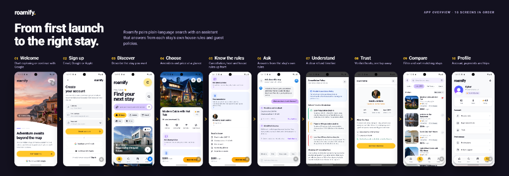

# Roamify 🏡✨

<p align="center">
  <strong>From first launch to the right stay.</strong><br>
  Intelligent stay discovery app built with Expo, React Native, Sanity Content Lake, Clerk, and Google Gemini AI.
</p>

<p align="center">
  
  
  
  
  
  
  
</p>

<br>

<p align="center">
  
</p>

<br>

> 💬 **Natural Language Stay Search in Action**  
> ```text
> "Quiet pet-friendly cabin with a hot tub in Lake Arrowhead under $300 a night"
> ```
> ↳ **Parsed in real-time:**  
> • **Category:** `Cabin` &nbsp;|&nbsp; **Location:** `Lake Arrowhead, CA` &nbsp;|&nbsp; **Budget:** `≤ $300/night`  
> • **Hard Amenities:** `Hot Tub` · `Pets Allowed` &nbsp;|&nbsp; **Soft Intent / Vibe:** `Quiet` · `Cozy` · `Secluded`

Roamify bridges natural conversational search with exact constraint filtering. Stays are ranked by semantic relevance and strict pricing/amenity filters, while guest questions about booking terms, cancellation policies, and house rules are answered **verbatim from verified Sanity policy text with zero hallucinated claims**.

---

## 📱 Seamless 10-Screen Guest Journey

| Step | Screen | Experience |
|:---:|---|---|
| **01** | **Welcome** | Cinematic splash carousel exploring featured global destinations |
| **02** | **Sign Up** | Clerk-authenticated onboarding via Email OTP or Google & Apple SSO |
| **03** | **Discover** | Natural sentence search bar with trending vibe chips & suggestions |
| **04** | **Choose** | High-res photo galleries, transparent per-night pricing, and instant favoriting |
| **05** | **Know the Rules** | Direct access to stay rules, check-in windows, and quiet hours up front |
| **06** | **Ask** | Conversational Q&A answered word-for-word from stay house rules & policies |
| **07** | **Understand** | Visual cancellation timeline & refund guarantee with clear tier dates |
| **08** | **Trust** | Verified host profiles ("Meet your host"), response rates, and badges |
| **09** | **Compare** | Fast filter refinement with price sorting and constraint tags |
| **10** | **Profile** | User account management, saved favorites, trips, and secure sign-out |

---

## ✨ Core Highlights

- **🔍 Natural Language Stay Search**  
  Describe your stay in plain words. Server-side structured extraction (powered by Google Gemini 2.5 Flash via Vercel AI SDK) converts queries into typed constraints and GROQ filters with strict confidence scoring (`low`, `medium`, `high`).
- **💬 Zero-Hallucination Policy Q&A**  
  Policy and house rule questions route through Sanity's Knowledge Base. Answers display the stay's verified facts and official policy passages word-for-word with explicit citations—no LLM makes up rules or fees.
- **🏡 30 Curated Stays & 10 Verified Hosts**  
  Seeded in Sanity with deterministic IDs, multi-photo galleries, geo-coordinates, and verified amenity tags. Powered by Sanity public CDN caching for instant loads.
- **🔐 Enterprise-Grade Authentication**  
  Secured by **Clerk** with automatic session token caching (`@clerk/expo/token-cache`), protected route groups `(auth)` vs `(app)`, and automatic route redirection.
- **🎨 Fluid Native Design System**  
  Engineered with **NativeWind v5 (Tailwind CSS v4)**, **Plus Jakarta Sans** typography, continuous iOS corner curvature, custom liquid glass bottom tab bar, and tactile haptic feedback on every touch.
- **📈 Privacy-First Telemetry**  
  Integrated with **PostHog** for product metrics with user identification upon login, total session reset on logout, and zero capture of typed queries or PII.

---

## 🛠 Tech Stack

| Domain | Tools & Libraries |
|---|---|
| **Core Framework** | [Expo SDK 58](https://expo.dev), [React Native 0.88](https://reactnative.dev), [Expo Router v58](https://docs.expo.dev/router/introduction/) |
| **Styling & Design** | [NativeWind v5](https://www.nativewind.dev/), [Tailwind CSS v4](https://tailwindcss.com/), `react-native-css`, Plus Jakarta Sans |
| **Authentication** | [Clerk](https://clerk.com/) (`@clerk/expo`, `@clerk/backend`) |
| **CMS & Knowledge Base** | [Sanity Studio v6](https://www.sanity.io/) (Content Lake, GROQ, Knowledge Base Mode) |
| **AI Engine** | [Google Gemini 2.5 Flash](https://ai.google.dev/) via [Vercel AI SDK](https://sdk.vercel.ai/) (`generateObject` + Zod schemas) |
| **Motion & Haptics** | React Native Reanimated 4, Gesture Handler, Expo Haptics |
| **Analytics** | [PostHog](https://posthog.com/) (`posthog-react-native`) |

---

## 📁 Repository Structure

```
Roamify/
├── assets/                  # App icons, splash screens, and overview showcase graphics
│   └── images/              # Onboarding slides, brand assets, and app overview
├── src/
│   ├── app/                 # Expo Router file-based screens & API routes
│   │   ├── (app)/           # Tab group: Home, Search, Trips, Profile
│   │   ├── (auth)/          # Authentication: Sign-in, Sign-up, Email OTP
│   │   ├── api/             # Backend API routes (/api/search, /api/ask)
│   │   ├── stay/[slug]/     # Stay details, Policy Q&A modal, and Trip summary
│   │   ├── design-system.tsx# Live component catalog & design token preview
│   │   └── onboarding.tsx   # Visual destination slider
│   ├── components/          # Reusable UI primitives, cards, inputs, and modals
│   ├── hooks/               # Stays hooks, search state machines, and Q&A loaders
│   ├── lib/                 # Sanity client, Clerk auth verification, search & PostHog
│   └── theme/               # Design tokens (colors, typography, spacing, radius, motion)
└── studio/                  # Sanity Studio schemas, migration scripts, and seed data
```

---

## 🚀 Getting Started

### 1. Prerequisites
- **Node.js** (v18+)
- **npm** or **bun**
- Physical device with **Expo Go** or an iOS/Android Simulator

### 2. Installation
```bash
git clone https://github.com/Anmol1578/Roamify.git
cd Roamify
npm install
```

### 3. Environment Variables
Create a `.env` file based on [.env.example](.env.example):
```bash
cp .env.example .env
```

| Key | Purpose |
|---|---|
| `EXPO_PUBLIC_CLERK_PUBLISHABLE_KEY` | Clerk Publishable Key (App client) |
| `CLERK_SECRET_KEY` | Clerk Secret Key (Server API verification) |
| `EXPO_PUBLIC_SANITY_PROJECT_ID` | Sanity Project ID |
| `EXPO_PUBLIC_SANITY_DATASET` | Sanity Dataset name (`production`) |
| `GOOGLE_GENERATIVE_AI_API_KEY` | Google Gemini API Key for search intent & Q&A |
| `SANITY_ORGANIZATION_TOKEN` | Sanity Org Token for Knowledge Base endpoints |
| `EXPO_PUBLIC_POSTHOG_KEY` | PostHog Token (Optional) |
| `EXPO_PUBLIC_POSTHOG_HOST` | PostHog Ingestion Host (Optional) |

### 4. Running the App
```bash
# Start Expo development server
npm run start
```
- Press <kbd>i</kbd> to launch on **iOS Simulator**
- Press <kbd>a</kbd> to launch on **Android Emulator**
- Scan the terminal QR code using **Expo Go**

---

## 🧪 Quality & Tests

```bash
# Validate TypeScript types across the entire project
npm run typecheck

# Run Expo ESLint checks
npm run lint
```

---

## 📄 License

Licensed under the [MIT License](LICENSE).
