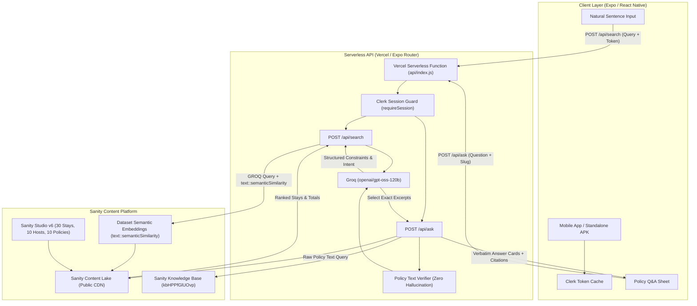

# Roamify 🏡✨

<p align="center">
  <strong>From first launch to the right stay.</strong><br>
  Intelligent vacation rental discovery app built with Expo SDK 58, React Native 0.88, Sanity Content Lake, Clerk, and Groq AI.
</p>

<p align="center">
  
  
  
  
  
  
  
  
  
</p>

<br>

<p align="center">
  
</p>

<br>

> 💬 **Natural Language Stay Search in Action**  
> ```text
> "Quiet pet-friendly cabin with a hot tub in Lake Arrowhead under $300 a night"
> ```
> ↳ **Parsed in real-time server-side:**  
> • **Category:** `Cabin` &nbsp;|&nbsp; **Location:** `Lake Arrowhead, CA` &nbsp;|&nbsp; **Budget:** `≤ $300/night`  
> • **Hard Amenities:** `Hot Tub` · `Pets Allowed` &nbsp;|&nbsp; **Soft Intent / Vibe:** `Quiet` · `Cozy` · `Secluded`

Roamify bridges natural conversational search with exact constraint filtering. Stays are ranked by semantic relevance and strict pricing/amenity filters, while guest questions about booking terms, cancellation policies, and house rules are answered **verbatim from verified Sanity policy text with zero hallucinated claims**.

---

## 📱 Seamless 10-Screen Guest Journey

| Step | Screen | Experience |
|:---:|---|---|
| **01** | **Welcome** | Cinematic destination carousel with immersive photography and smooth onboarding transitions |
| **02** | **Sign Up** | Clerk-authenticated onboarding via Email OTP or Google & Apple SSO with secure token caching |
| **03** | **Discover** | Natural sentence search bar with trending vibe chips, recent suggestions, and category tabs |
| **04** | **Choose** | High-resolution photo galleries, transparent per-night pricing, and instant favoriting |
| **05** | **Know the Rules** | Direct access to stay rules, check-in windows, quiet hours, and house guidelines up front |
| **06** | **Ask** | Conversational Q&A answered word-for-word from stay house rules & policies with citations |
| **07** | **Understand** | Visual cancellation timeline & refund guarantee with clear tier dates and policy badges |
| **08** | **Trust** | Verified host profiles ("Meet your host"), response rates, badges, and hosted properties |
| **09** | **Compare** | Fast filter refinement with price sorting, amenity toggles, and live stay counts |
| **10** | **Profile** | User account management, saved favorites, trips, and secure Clerk session sign-out |

---

## 🏛 System Architecture & Data Flow



---

## ✨ Core Highlights & Innovations

- **🔍 Natural Language Stay Search**  
  Describe your stay in plain words ("quiet cabin with hot tub under $300"). Server-side structured extraction (powered by Groq `openai/gpt-oss-120b` via AI SDK) converts natural queries into typed constraints and GROQ filters with strict confidence scoring (`low`, `medium`, `high`).
- **💬 Zero-Hallucination Policy Q&A**  
  Policy and house rule questions route through Sanity's Knowledge Base (`kbHPPfGlUOvp`). Answers display the stay's verified facts and official policy passages word-for-word with explicit citations—no LLM makes up rules, hidden costs, or refund dates.
- **🏡 30 Curated Stays & 10 Verified Hosts**  
  Seeded in Sanity Content Lake with deterministic IDs, multi-photo galleries, geo-coordinates, and verified amenity tags. Powered by Sanity public CDN caching for instant loads.
- **🔐 Enterprise-Grade Authentication**  
  Secured by **Clerk** with automatic session token caching (`@clerk/expo/token-cache`), protected route groups `(auth)` vs `(app)`, and automatic route redirection.
- **🎨 Fluid Native Design System**  
  Engineered with **NativeWind v5 (Tailwind CSS v4)**, **Plus Jakarta Sans** typography, continuous iOS corner curvature, custom liquid glass bottom tab bar (`GlassTabBar`), and tactile haptic feedback on every touch.
- **🌐 Cloud API & Standalone APK**  
  Expo Router server routes (`/api/search`, `/api/ask`) compile and deploy seamlessly to Vercel via `@expo/server` adapter, enabling standalone Android APKs built with EAS to connect securely to live AI and CMS services.
- **📈 Privacy-First Telemetry**  
  Integrated with **PostHog** for product metrics with user identification upon login, total session reset on logout, and zero capture of typed queries or PII.

---

## 🛠 Tech Stack

| Domain | Tools & Libraries | Description |
|---|---|---|
| **Core Framework** | [Expo SDK 58](https://expo.dev), [React Native 0.88](https://reactnative.dev) | High-performance native mobile engine |
| **Routing & Navigation** | [Expo Router v58](https://docs.expo.dev/router/introduction/) | Typed file-based routing with server routes |
| **Styling & Design** | [NativeWind v5 RC0](https://www.nativewind.dev/), [Tailwind CSS v4](https://tailwindcss.com/) | Tailwind compiler with `react-native-css` |
| **Typography** | Plus Jakarta Sans | Custom Google font typography tokens |
| **Authentication** | [Clerk](https://clerk.com/) (`@clerk/expo`, `@clerk/backend`) | Session tokens, secure storage cache & route guards |
| **CMS & Knowledge Base** | [Sanity Studio v6](https://www.sanity.io/) | Content Lake, GROQ, Knowledge Base Mode |
| **AI Inference** | [Groq](https://groq.com/) (`openai/gpt-oss-120b`) | Ultra-fast structured outputs via AI SDK |
| **Motion & Haptics** | React Native Reanimated 4, Gesture Handler, Expo Haptics | 60/120fps physics animations and touch feedback |
| **Backend & Serverless** | [Vercel](https://vercel.com/) via `@expo/server/adapter/vercel` | Serverless deployment for Expo Router API endpoints |
| **DevOps & Builds** | [EAS CLI](https://expo.dev/eas) | Cloud builds for standalone Android APKs and iOS |
| **Product Analytics** | [PostHog](https://posthog.com/) (`posthog-react-native`) | Anonymous privacy-preserving product telemetry |

---

## 📁 Repository Structure

```
Roamify/
├── api/                     # Vercel serverless function entry handler (api/index.js)
├── assets/                  # App icons, splash screens, and showcase graphics
│   └── images/              # Onboarding slides, brand assets, and app overview
├── prompts/                 # Project history, architecture specs, and step-by-step plans
├── src/
│   ├── app/                 # Expo Router file-based screens & API routes
│   │   ├── (app)/           # Protected tab group: Home, Search, Trips, Profile
│   │   ├── (auth)/          # Authentication: Sign-in, Sign-up, Email OTP
│   │   ├── api/             # Server API routes (POST /api/search, POST /api/ask)
│   │   ├── stay/[slug]/     # Stay details, Policy Q&A modal, and Trip summary
│   │   ├── design-system.tsx# Live component catalog & design token preview
│   │   └── onboarding.tsx   # Visual destination slider
│   ├── components/          # Reusable UI primitives, cards, inputs, and modals
│   ├── hooks/               # Stays hooks, search state machines, and Q&A loaders
│   ├── lib/                 # Sanity client, Clerk auth verification, search & PostHog
│   └── theme/               # Design tokens (colors, typography, spacing, radius, motion)
├── studio/                  # Sanity Studio schemas, migration scripts, and seed data
│   ├── schemaTypes/         # Property, Host, Policy, and Review schemas
│   └── scripts/             # Data seeding and image deduplication scripts
├── eas.json                 # EAS build configuration (Preview APK, Production)
├── vercel.json              # Vercel serverless deployment config for Expo web export
└── package.json             # Root dependencies and project scripts
```

---

## 🚀 Getting Started

### 1. Prerequisites
- **Node.js** (v18 or higher)
- **npm** or **bun**
- Physical device with **Expo Go** or an iOS Simulator / Android Emulator

### 2. Installation
```bash
# Clone the repository
git clone https://github.com/Anmol1578/Roamify.git
cd Roamify

# Install dependencies (use npx expo install for native packages)
npm install
```

### 3. Environment Variables
Create a `.env` file in the project root:
```bash
cp .env.example .env
```

Fill in the required configuration keys:

| Environment Variable | Description | Source |
|---|---|---|
| `EXPO_PUBLIC_CLERK_PUBLISHABLE_KEY` | Clerk Publishable Key for client authentication | [Clerk Dashboard](https://dashboard.clerk.com) |
| `CLERK_SECRET_KEY` | Clerk Secret Key for server-side route validation | [Clerk Dashboard](https://dashboard.clerk.com) |
| `EXPO_PUBLIC_SANITY_PROJECT_ID` | Sanity Project ID for Content Lake queries | [Sanity Manage](https://www.sanity.io/manage) |
| `EXPO_PUBLIC_SANITY_DATASET` | Sanity Dataset name (`production`) | [Sanity Manage](https://www.sanity.io/manage) |
| `GROQ_API_KEY` | Groq API Key for intent parsing and Q&A | [Groq Console](https://console.groq.com) |
| `SANITY_ORGANIZATION_TOKEN` | Sanity Org Token for Knowledge Base access | [Sanity Manage](https://www.sanity.io/manage) |
| `SANITY_CONTEXT_MCP_URL` | Sanity Context MCP search endpoint | Sanity Context App |
| `SANITY_POLICIES_MCP_URL` | Sanity Policies MCP endpoint | Sanity Context App |
| `SANITY_CONTEXT_KB_URL` | Sanity Context Knowledge Base endpoint (`kbHPPfGlUOvp`) | Sanity Context App |
| `EXPO_PUBLIC_API_URL` | Deployed backend base URL (e.g. `https://roamify-studio.vercel.app`) | Vercel Deployment |
| `EXPO_PUBLIC_POSTHOG_KEY` | PostHog API project token *(Optional)* | [PostHog](https://posthog.com) |
| `EXPO_PUBLIC_POSTHOG_HOST` | PostHog Ingestion Host URL *(Optional)* | [PostHog](https://posthog.com) |

> 🔒 **Security Note:** Keys without the `EXPO_PUBLIC_` prefix (`CLERK_SECRET_KEY`, `GROQ_API_KEY`, `SANITY_ORGANIZATION_TOKEN`) are strictly confidential and never bundled into the client app.

---

### 4. Running the Development Server
```bash
# Start the Expo development server
npm run start
```
- Press <kbd>i</kbd> to launch on **iOS Simulator**
- Press <kbd>a</kbd> to launch on **Android Emulator**
- Press <kbd>w</kbd> to launch in **Web Browser**
- Scan the terminal QR code using **Expo Go** on your physical device

---

### 5. Sanity Studio & Content Seeding

Manage listings, hosts, policies, and reviews via the embedded Sanity Studio:

```bash
# Navigate to the studio directory
cd studio

# Install studio dependencies
npm install

# Start local Sanity Studio development server
npm run dev

# Seed 30 properties, 10 hosts, and 10 policies to Sanity Content Lake
npx tsx scripts/seed.ts

# Verify that there are no duplicate image URLs across listings
npx tsx scripts/check-duplicates.ts

# Deploy Sanity Studio to production
npm run deploy
```

---

## ☁️ Production Deployment

### 1. Deploy API Routes to Vercel
Roamify's server routes (`/api/search` and `/api/ask`) are configured to deploy as a Vercel Serverless Function:

1. Connect the repository to [Vercel](https://vercel.com).
2. Set the build command to `npx expo export -p web` and output directory to `dist/client` (configured automatically via `vercel.json`).
3. Add the server environment variables in your Vercel Project Settings:
   - `CLERK_SECRET_KEY`
   - `GROQ_API_KEY`
   - `SANITY_ORGANIZATION_TOKEN`
   - `EXPO_PUBLIC_SANITY_PROJECT_ID`
   - `EXPO_PUBLIC_SANITY_DATASET`
   - `SANITY_CONTEXT_MCP_URL`
   - `SANITY_POLICIES_MCP_URL`
   - `SANITY_CONTEXT_KB_URL`
4. Deploy the project and note your production URL (e.g., `https://roamify-studio.vercel.app`).

### 2. Build Standalone Android APK (EAS)
Build an installable preview APK that connects directly to your deployed Vercel backend:

```bash
# Build standalone Android APK via EAS
npx eas-cli@latest build -p android --profile preview
```

---

## 🧪 Code Quality & Verification

```bash
# Run TypeScript typecheck across all files
npm run typecheck

# Run Expo ESLint checks
npm run lint

# Check Expo dependencies for compatibility
npx expo-doctor
```

---

## 📄 License

Licensed under the [MIT License](LICENSE).
